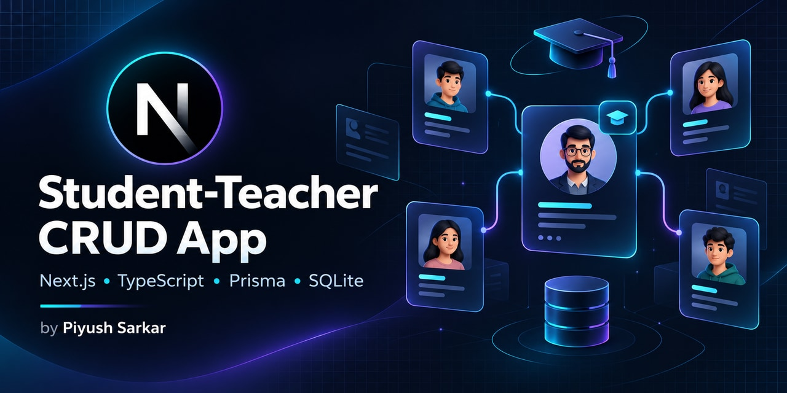
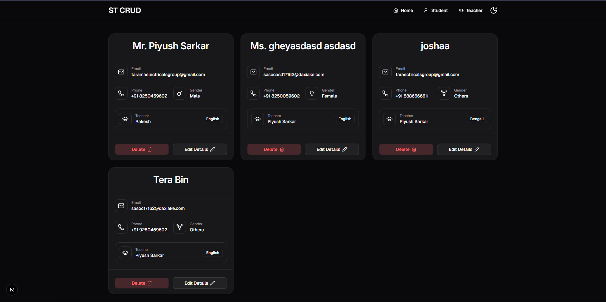
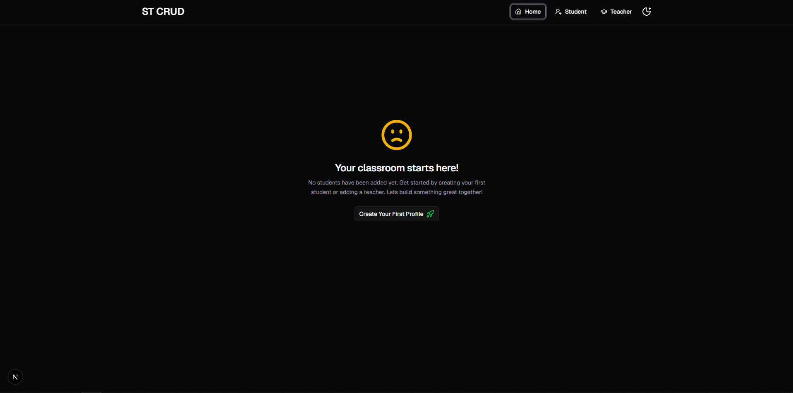
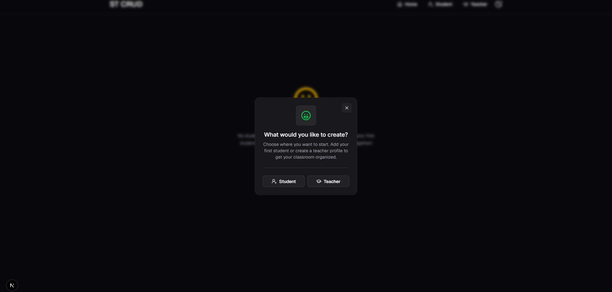
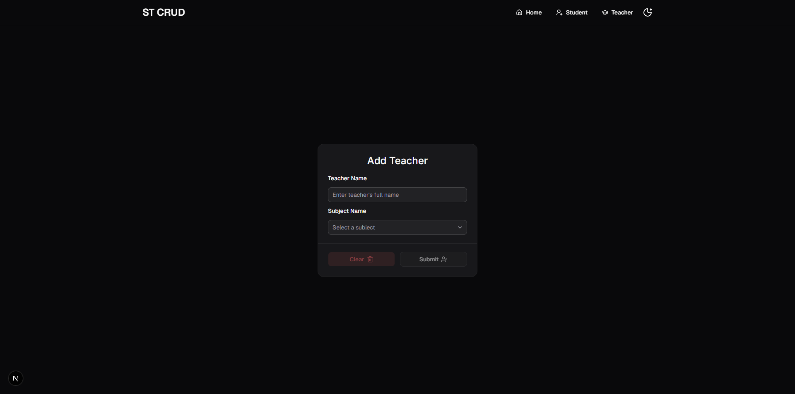
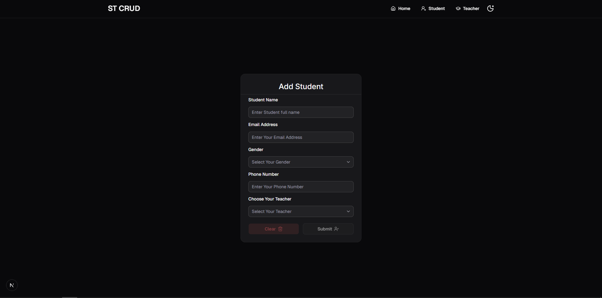
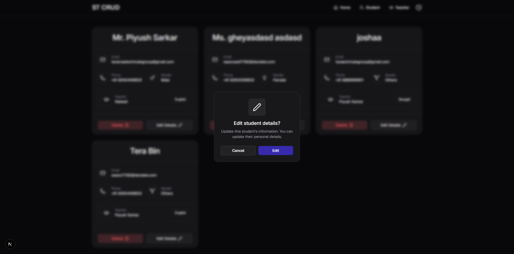
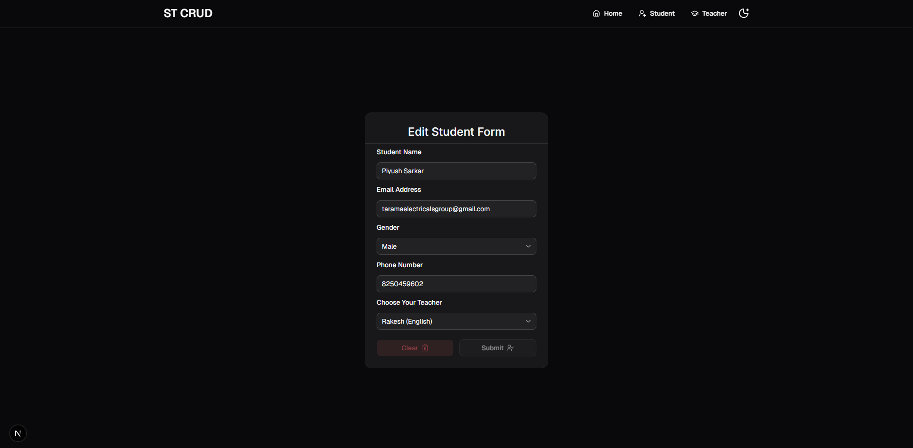
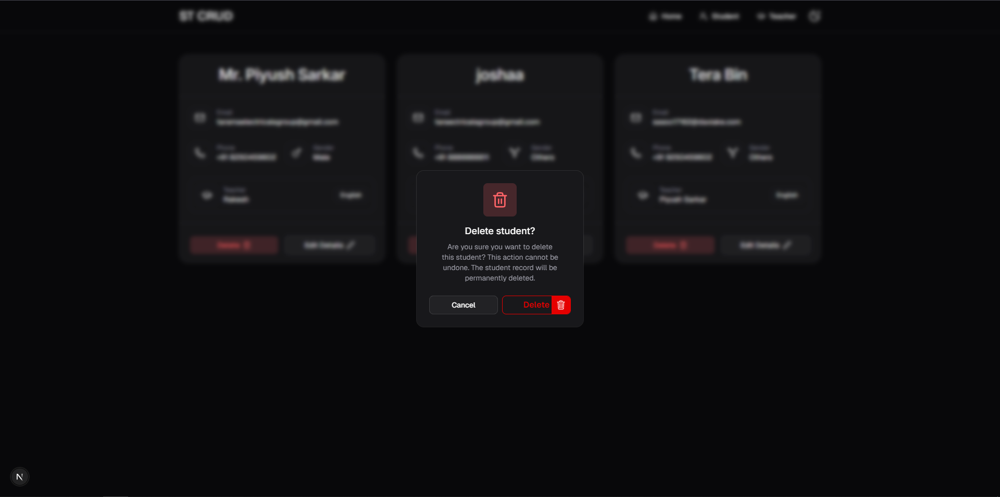
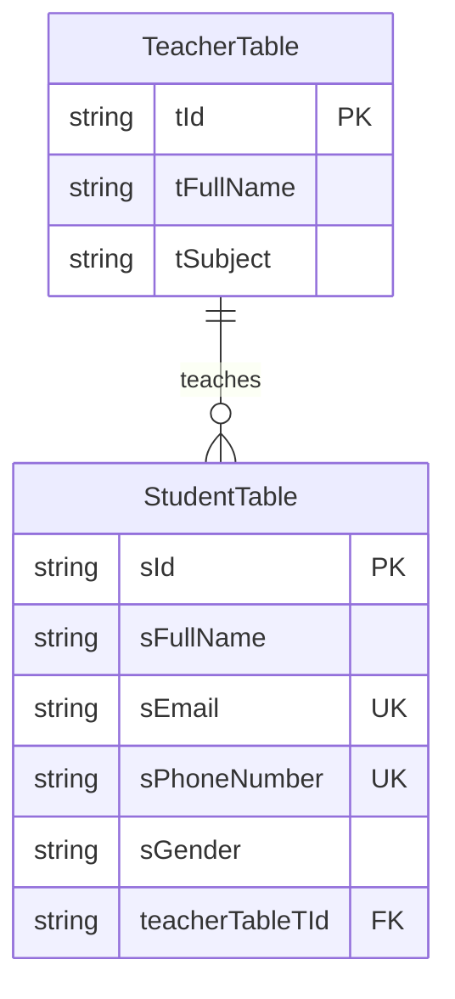

<p align="center">
  
</p>

<h1 align="center">Student-Teacher CRUD App with Next.js</h1>

<p align="center"><strong>A simpler way to organize your classroom.</strong></p>

<p align="center">
  Create teachers. Connect students. Keep every profile up to date.<br />
  A student management CRUD application built with Next.js, React, TypeScript, Prisma, and SQLite.
</p>

<p align="center">
  
  
  
  
  
</p>

<p align="center"><a href="#screenshots">Screenshots</a> · <a href="#getting-started">Getting started</a> · <a href="#database-design">Database design</a> · <a href="#available-scripts">Scripts</a></p>

<br />

<p align="center">
  
</p>

<p align="center"><sub>Student profiles, teacher assignments, and everyday actions in one place.</sub></p>

---

## Overview

**Student-Teacher CRUD App** is a full-stack **Next.js CRUD application** for student management and teacher assignment. It implements create, read, update, and delete operations for student records using the Next.js App Router, React, TypeScript, Prisma ORM, and a local SQLite database.

Create a teacher first, then add students and link each one to a teacher. The home page shows student contact details alongside the teacher's name and subject, with controls for editing or deleting each student. Forms use React Hook Form and Zod, while Tailwind CSS and shadcn/ui provide the interface.

### What you can learn from this CRUD project

- Build student management forms with React, TypeScript, and Zod validation.
- Use Next.js Server Actions to create, update, and delete database records.
- Model a teacher-to-students relationship with Prisma and SQLite.
- Display related records with React Server Components and refresh data after mutations.

## Features

- Create teacher profiles with a name and subject.
- Create students with a name, email, phone number, gender, and assigned teacher.
- View all students and their teacher details on the home page, including a dedicated empty state when no students exist.
- Edit student details and change their teacher assignment.
- Delete students after a confirmation dialog; editing also opens a confirmation dialog.
- Validate forms with Zod and React Hook Form. Student email and phone number are unique in the database.
- Switch between light and dark themes. The interface uses responsive cards and toast feedback for form actions.

## Screenshots

All eight screenshots from [public/demo](./public/demo/) are included below. Click a screenshot to open the original image.

<p align="center">
  <a href="./public/demo/home-with-student-details.png"></a><br />
  <sub>Student records with contact details, assigned teachers, and edit and delete actions.</sub>
</p>

### 01 · First steps

<table>
  <tr>
    <td align="center" width="50%"><a href="./public/demo/home-no-student.png"></a><br /><sub>Empty home page</sub></td>
    <td align="center" width="50%"><a href="./public/demo/get-started-t-s.png"></a><br /><sub>Choose what to create</sub></td>
  </tr>
</table>

### 02 · Teacher management

<p align="center"><a href="./public/demo/creatye-teacher.png"></a><br /><sub>Create a teacher before assigning one to a student</sub></p>

### 03 · Create a student

<p align="center">
  <a href="./public/demo/create-student.png"></a><br />
  <sub>Enter the student's details and select an existing teacher.</sub>
</p>

### 04 · Edit student details

#### Step 1: Confirm editing

Select **Edit Details** on a student card, then choose **Edit** in the confirmation dialog.

<p align="center">
  <a href="./public/demo/edit-button-alert.png"></a><br />
  <sub>Edit Details confirmation dialog</sub>
</p>

#### Step 2: Update the student form

Change the student's name, email, gender, phone number, or assigned teacher, then submit the form.

<p align="center">
  <a href="./public/demo/edit-student-details.png"></a><br />
  <sub>Edit Student Details form</sub>
</p>

### 05 · Delete a student

<p align="center">
  <a href="./public/demo/delet-button-alert.png"></a><br />
  <sub>Review the confirmation before permanently deleting a student.</sub>
</p>

## Technology stack

| Area          | Technologies                                                                       |
| ------------- | ---------------------------------------------------------------------------------- |
| App           | Next.js 16.3, React 19.2, TypeScript 5.9                                           |
| Interface     | Tailwind CSS 4.3, shadcn/ui components built on Base UI, Lucide icons, next-themes |
| Forms         | React Hook Form 7.91, Zod 4.5, `@hookform/resolvers`                               |
| Data          | Prisma 7.10, SQLite, `@prisma/adapter-libsql`                                      |
| Configuration | `@t3-oss/env-nextjs` for environment validation                                    |

Versions reflect the ranges declared in [`package.json`](./package.json).

## Database design

The [Prisma schema](./prisma/schema.prisma) defines `TeacherTable` and `StudentTable`. A teacher can have many students. Every student must reference one teacher through `teacherTableTId`. Student email addresses and phone numbers each have a unique constraint. The existing migration restricts deleting a teacher while students still reference that teacher.



Prisma Client is generated into `generated/prisma/`. Server actions in `src/server/` perform writes; App Router pages read records with Prisma.

## Project structure

```text
prisma/
  migrations/           SQLite migration history
  schema.prisma         Teacher and student models
public/demo/            Application screenshots
src/
  app/                  Home, create student, create teacher, edit student pages
  components/
    customui/           Forms and student cards
    Layout/             Header and theme toggle
    Providers/          Theme provider
    shadcnui/           UI primitives
  lib/
    dbClient/           Prisma client and libSQL adapter
    env/                Environment validation
    zodSchema.ts        Form schemas
  server/               Create, edit, and delete server actions
prisma.config.ts        Prisma schema, migration, and database settings
components.json         shadcn/ui configuration
```

## Getting started

### Prerequisites

- Node.js 24 or newer
- npm 11 or newer

The same commands work in PowerShell, Command Prompt, and POSIX shells, except for the environment file copy command shown separately below.

1. Clone the repository and install dependencies:

   ```sh
   git clone https://github.com/piyushsarkar-dev/student-teacher-crud-app.git
   cd student-teacher-crud-app
   npm install
   ```

2. Copy the environment template:

   **PowerShell**

   ```powershell
   Copy-Item .env.example .env
   ```

   **Command Prompt**

   ```bat
   copy .env.example .env
   ```

   **macOS / Linux**

   ```sh
   cp .env.example .env
   ```

   The template sets `DATABASE_URL=file:./prisma/dev.db` for a local SQLite database. Keep `.env` private.

3. Apply the existing migration and generate Prisma Client:

   ```sh
   npm run migrate
   ```

   `migrate` runs `prisma migrate dev` followed by `prisma generate`. If you need to regenerate the client later without migrating, run `npx prisma generate`.

4. Start the development server:

   ```sh
   npm run dev
   ```

   Open [http://localhost:3000](http://localhost:3000). Create a teacher first so the student form has a teacher to assign.

## Available scripts

| Command              | Purpose                                                                    |
| -------------------- | -------------------------------------------------------------------------- |
| `npm run dev`        | Start the Next.js development server.                                      |
| `npm run build`      | Generate Prisma Client, then build the Next.js app.                        |
| `npm run start`      | Start the production server after a build.                                 |
| `npm run lint`       | Run ESLint.                                                                |
| `npm run lint:check` | Generate Next.js route types, type check with TypeScript, then run ESLint. |
| `npm run migrate`    | Run development migrations and generate Prisma Client.                     |
| `npm run studio`     | Start Prisma Studio without opening a browser automatically.               |

## CRUD workflow

1. **Create a teacher:** Visit `/teacher/create`, enter a name, and select a subject. After a successful save, the app opens the student creation page.
2. **Create a student:** Visit `/student/create`, enter the student's details, and choose an existing teacher. The app returns to the home page after a successful save.
3. **Read records:** The home page lists students with their contact details, gender, assigned teacher, and subject.
4. **Update a student:** Choose **Edit Details** on a student card, confirm, edit the form at `/student/[sId]`, and submit.
5. **Delete a student:** Choose **Delete** on a student card and confirm the permanent deletion.

Teacher editing and deletion are not currently implemented in the app.

## Future improvements

Teacher edit and delete flows are possible extensions. The current interface supports creating teachers and selecting them for students.

## License

Released under the [MIT License](./LICENSE).

---

<p align="center">
  <em>“Every small project is a step toward building something meaningful.”</em>
</p>

<p align="center">
  <strong>Author: Piyush Sarkar</strong><br />
  <sub>Built with curiosity, care, and a passion for learning.</sub>
</p>
